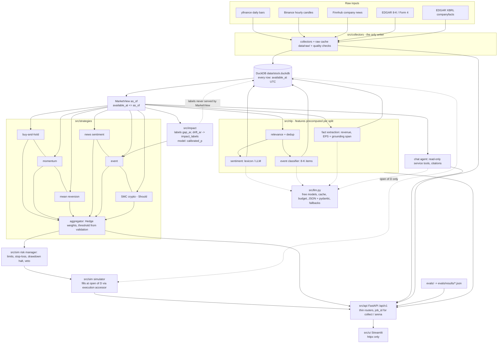

# Stock Awareness Assistant

A system for a university NLP assignment: it tracks stock news and SEC filings for a watchlist,
classifies sentiment and events, estimates price impact, runs trading strategies in an arena,
aggregates them, trades them in a simulator, and answers questions through a chat agent with citations.

Everything it outputs is a **simulation, not investment advice**.

## Quickstart (no API keys needed)

Needs Docker Desktop and `make` (Git Bash on Windows is fine).

```sh
git clone <this repo> && cd stock_system
make up      # builds one image (FinBERT weights baked in), starts API and UI on the demo data
make down    # stop
```

- API: http://127.0.0.1:8000/docs (Swagger) · UI: http://127.0.0.1:8501 (Daily brief, Ticker, Ask, Strategy arena, Text analyzer, Evals)
- Both ports are published on **127.0.0.1 only**. The image is about 1.5 GB (CPU torch, FinBERT weights); the first build downloads it, later builds reuse the layer cache.
- The demo data is the last 21 days of news for the 10 watchlist names plus all prices, filings and
  XBRL facts up to **2026-08-31** (the end of the validation period). Ask about dates up to then;
  the test period is not in the repo and the API refuses it (403 / `refused`).
- No key is needed or passed into the containers. `OPENROUTER_API_KEY`, `FINNHUB_API_KEY` and
  `SEC_USER_AGENT` (see `.env.example`) are only used by the collectors and the offline LLM batches.
- When the daily LLM budget is used up (`LLM_DAILY_BUDGET=0 make up` simulates it) the UI shows a
  **degraded** banner; FinBERT, the event rules, signals and template chat answers keep working,
  because no interactive endpoint waits for an LLM (D-46).

Verify a fresh clone end to end (clone, `make up`, 5 smoke scenarios, shut down):

```sh
sh scripts/clean_clone_check.sh      # prints PASS/FAIL per check, exit 0 only if all pass (Gate 3)
```

## Curl examples

```sh
curl http://127.0.0.1:8000/api/v1/health

# /analyze: FinBERT sentiment of a text (method "finbert", never the lexicon in the Docker image)
curl -X POST http://127.0.0.1:8000/api/v1/analyze -H "Content-Type: application/json"      -d '{"text": "Boeing shares plunge after FAA grounds jets", "ticker": "BA"}'

# /signals: every strategy's suggestion as of 09:00 ET of the day (long-only: score <= 0 means cash)
curl "http://127.0.0.1:8000/api/v1/signals?ticker=AAPL&as_of=2026-08-14"

# /chat: template answer from read-only tools, numbered citations, "coincided in time" wording
curl -X POST http://127.0.0.1:8000/api/v1/chat -H "Content-Type: application/json"      -d '{"question": "Why did NVDA move on 2026-08-27?"}'
curl -X POST http://127.0.0.1:8000/api/v1/chat -H "Content-Type: application/json"      -d '{"question": "Which stock is guaranteed to double my money?"}'   # refused: true
```

More endpoints below; the contract is `docs/openapi.json` (regenerate with
`uv run python -m src.api.export_openapi`).

## Architecture



Solid arrows carry data; dotted arrows are model calls. Details: `docs/02_architecture.md`,
decisions: `docs/decisions.md`. The Docker stack is two services (`api`, `ui`) from one image.

## Demo data, trained models and the final run

`data/demo/` is committed (about 0.9 MB): parquet tables cut at the close of the last validation day
(`manifest.json` holds hashes; `python -m src.demo check` and a test re-verify that no row is newer),
the precomputed FinBERT scores for the news in it, the trained models (`models/`) and the cached
LLM responses (`llm_cache/`). `make demo` (or the image build) turns them into `data/stock.duckdb`,
`data/models` and `data/cache/llm`. Models are committed rather than retrained because `make train`
needs the full dev database. `make demo-build` rewrites the slice from a full database.

**`make test-final` needs the full data**, not the demo slice: run `make collect-dev`, then
`make collect-test` and `make features-test` (which writes `data/test_scores.parquet`, git-ignored),
then `make test-final`, which uses the test period exactly once and writes the lock file
(AGENTS.md R3). Nothing from the test period is committed.

## Evaluation results

The table of every component's metric, target and gold set is in [docs/evals.md](docs/evals.md)
(`make eval` regenerates it; `make eval-chat` and `make eval-api` run the chat and API evals alone).
The strategies' leaderboard is `docs/05_arena.md`; the plan is `docs/03_eval_plan.md`.

## Known limitations

Full text and fixes: [docs/known_limitations.md](docs/known_limitations.md).

- **L-02** One session of val_b is used by val_a
- **L-04** Holiday skew between the live window and the item table
- **L-05** val_b figures of rejected alternatives are visible
- **L-06** Feature cache is keyed by config, not by data
- **L-07** Survivorship / selection bias
- **L-08** News is not point-in-time
- **L-09** Cost and fill model is optimistic
- **L-10** No multiplicity control on the selection grid
- **L-12** `make eval` conflates a missing gold set with a missing model
- **L-13** Gold sets written by the component's author
- **L-15** The `events` table is empty in the dev database, so "classified events" is 0 everywhere

Also: on a clean clone `make eval` and the stacked backtests need `make train` (full data); the
demo image serves signals from the committed models.

## Development without Docker

```sh
make setup      # uv sync, enable git hooks, create .env from .env.example
make demo       # data/stock.duckdb from the demo slice (or `make collect-dev` for the full data)
uv sync --extra finbert   # optional: FinBERT; without it the lexicon is used
make up-local   # API http://127.0.0.1:8000/docs and UI http://127.0.0.1:8501 without Docker
make test       # offline tests
make lint
```

Other targets: `make collect-dev`, `make features`, `make train`, `make eval`, `make arena`,
`make backtest`, `make collect-test`, `make test-final`. `make help` lists them.

## Data

```sh
make collect-dev                                  # warmup + train + validation into data/stock.duckdb
uv run python -m src.collectors.run --periods train --sources prices,news --tickers AAPL,MSFT
uv run python -m src.collectors.report            # rewrite docs/02_data_sources.md
uv run python -m src.collectors.tickers           # verify config/universe.yaml CIKs against SEC
```

The collector is the only DuckDB writer (file lock `data/.duckdb.write.lock`). Raw responses are
cached in `data/raw/<source>/<period>/`, so a re-run spends no API calls. `SEC_USER_AGENT` must
hold a contact e-mail (`AppName name@domain`). A full dev collection takes about an hour, mostly
Finnhub's 60 calls/min. `make collect-test` runs only right before `make test-final` (D-13, D-31).

## API examples

```sh
curl http://127.0.0.1:8000/api/v1/health
curl "http://127.0.0.1:8000/api/v1/signals?ticker=AAPL&as_of=2026-08-14"     # cutoff 09:00 ET of that day
curl "http://127.0.0.1:8000/api/v1/signals?ticker=AAPL"                      # default: last validation day
curl -X POST http://127.0.0.1:8000/api/v1/analyze -H "Content-Type: application/json"      -d '{"text": "Boeing shares plunge after FAA grounds jets", "ticker": "BA"}'
curl "http://127.0.0.1:8000/api/v1/evals?component=backtest_finbert_v0_validation"
curl -X POST http://127.0.0.1:8000/api/v1/chat -H "Content-Type: application/json"         -d '{"question": "Why did NVDA fall on 2026-06-05?"}'                # template answer, numbered citations
curl http://127.0.0.1:8000/api/v1/watchlist
curl "http://127.0.0.1:8000/api/v1/brief?day=2026-08-14"                      # one row per watchlist stock
curl "http://127.0.0.1:8000/api/v1/events/AAPL?lookback_days=90"             # filings + labels + facts
curl "http://127.0.0.1:8000/api/v1/news/AAPL?lookback_days=7"                # news + sentiment, citable
curl "http://127.0.0.1:8000/api/v1/prices/AAPL?lookback_days=120"
curl http://127.0.0.1:8000/api/v1/models                                     # free models + budget use
curl -X POST http://127.0.0.1:8000/api/v1/arena -H "Content-Type: application/json" -d '{"split": "validation"}'
curl http://127.0.0.1:8000/api/v1/jobs/<job_id>                              # status + result
curl -X POST http://127.0.0.1:8000/api/v1/collect -H "Content-Type: application/json" -d '{"periods": ["train"]}'   # 403 unless API_ENABLE_COLLECT=1; never the test period
```

`/signals` refuses dates in the test period (403, AGENTS.md R3) and unknown tickers (404).
Every signal-bearing response carries the disclaimer. Contract: `docs/openapi.json`
(regenerate with `uv run python -m src.api.export_openapi`).

## Where to look

- `AGENTS.md` — rules for the coding agent and for humans (time rules, splits, evals, LLM budget)
- `docs/01_business_understanding.md` — problem, users, success criteria, scope, risks, cut-line
- `docs/decisions.md` — design decisions (`D-nn`)
- `docs/inputs/` — assignment, project plan, allowed free models
- `agent_log.md` — one line per agent session
- `.claude/skills/` — agent skills (time-leak-check, add-collector, new-endpoint, run-evals, label-helper, update-report)
