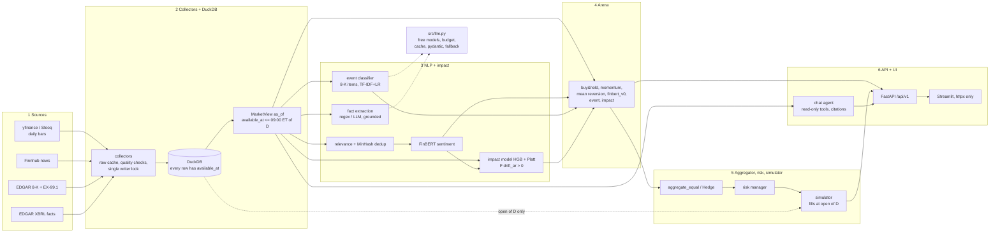

# Stock Awareness Assistant — Report

University NLP assignment (homework 1). Repository state: tag `freeze-1` (`47d8c2a`) for everything
fitted or chosen; the single test-period run followed on top of it (section 7).

> **Everything this system outputs is a simulation, not investment advice.** News and filings are
> reported as *coinciding with* or *preceding* price moves, never as causing them.

Every number in this report is copied from `evals/results/*.json` or `config/*.yaml`. Design
choices are cited by id (`D-nn`, [docs/decisions.md](docs/decisions.md)), and known weaknesses by
id (`L-nn`, [docs/known_limitations.md](docs/known_limitations.md)).

---

## 1. Task and scope

**Problem.** A retail investor with a watchlist of US stocks cannot read every news item and SEC
filing. Each morning before the open they want to know what happened to their tickers, what kind
of event it was, what such events have coincided with in price, and what a set of transparent
strategies would do. They also want to ask "why did X move?" and get an answer that cites its
sources. Finally, they want to know whether those suggestions would have made money, measured
honestly in a simulator instead of claimed.
([docs/01_business_understanding.md](docs/01_business_understanding.md))

**What was built.** For a 10-name watchlist (AAPL, MSFT, NVDA, JPM, GS, XOM, WMT, MCD, JNJ, BA)
inside a 77-name S&P 100 universe, with SPY as the benchmark, the system:

1. collects daily prices, Finnhub company news, SEC 8-K filings (items and press releases) and
   XBRL facts into DuckDB, stamping every row with `available_at`;
2. deduplicates news and filters it for relevance, scores sentiment (FinBERT, with a lexicon
   baseline), labels events in the 8-K item taxonomy, and extracts revenue, net income and EPS
   from earnings releases;
3. labels the abnormal return after each decision day and fits a calibrated direction model;
4. runs eight strategies in an arena with bootstrap CIs, random controls and a deflated Sharpe;
5. aggregates three NLP-driven components and trades them through a long-only simulator with a
   risk manager;
6. serves all of this through a FastAPI layer, a Streamlit client, and a chat agent that answers
   "why did X move?" from read-only tools, with numbered citations.

**Why this scope.** The Must list in docs/01 keeps the parts that the assignment grades (an NLP
pipeline with an eval per component, CRISP-DM, agent instructions, a demo) and the parts that make
the outputs honest (point-in-time data, frozen splits, controls). Should items (SMC on crypto,
contrarian and insider strategies, stacking, the LLM researcher, a scheduler, Langfuse, the
masking experiment) were started only once the Must list was green, and in the end none of them
were (section 8).

**Users and interfaces.** The investor uses the Streamlit UI (daily brief, signals, events, arena,
chat). Scripts use the REST API (`/api/v1`, Swagger at `/docs`). The grader runs
`make setup && make up` from a clean clone on a committed demo slice that needs no API keys
([README.md](README.md)).

**Out of scope.** Real trading, intraday trading, shorting, non-US markets, authentication and
multiple users.

---

## 2. CRISP-DM by phase

Each phase had a gate artifact. A phase was not started before the previous artifact was committed
(AGENTS.md §2).

| Phase | Gate artifact | What it contains |
|---|---|---|
| Business understanding | [docs/01_business_understanding.md](docs/01_business_understanding.md) | problem, users, success criteria per component with "why this metric", Must/Should/Could, 2-day cut-line, risks |
| Data understanding | [docs/02_data_understanding.md](docs/02_data_understanding.md), [docs/02_data_sources.md](docs/02_data_sources.md), figures in [docs/figs/](docs/figs/) | coverage per ticker and day, publication hours (43 % of news before the open), duplicates (32 % multi-ticker articles, 0.13 % syndicated copies), 8-K item distribution, gap vs drift returns |
| Data preparation | [docs/04_data_quality.md](docs/04_data_quality.md), `make collect-dev`, [config/splits.yaml](config/splits.yaml) | collectors write DuckDB under one writer lock (R7); quality checks (0 failures, 15 warnings for real >20 % moves); frozen, hash-pinned splits (D-05) |
| Modeling | `src/nlp`, `src/impact`, `src/strategies`, `src/sim`; [docs/03_eval_plan.md](docs/03_eval_plan.md) | every component has a service function, an offline unit test and an eval script writing `evals/results/<component>.json` |
| Evaluation | [docs/evals.md](docs/evals.md), [docs/05_arena.md](docs/05_arena.md), [docs/gate2_review.md](docs/gate2_review.md), [docs/06_final_run.md](docs/06_final_run.md) | `make eval` regenerates the table; every score below target is explained; an independent Gate 2 review audited time leaks; the single test run (section 7) |
| Deployment | [README.md](README.md), `Dockerfile`, `docker-compose.yml`, `scripts/clean_clone_check.sh` | `make up` builds the image (FinBERT baked in) and starts the API and UI on 127.0.0.1; the clean-clone check passed 21 of 21 scenarios (incl. no LLM access and an exhausted budget) |

The phases were not a single pass. The data-understanding audit changed the relevance rules
(multi-ticker articles), and the Gate 2 review (evaluation) sent work back to modeling: the arena's
random controls and deflated Sharpe (D-42), and the Hedge grid (D-44).

---

## 3. Architecture and components

Solid arrows carry data. Dotted arrows are model calls, or the one sanctioned exception: only
`src/sim` reads the open of D. The full diagram, with every record's `available_at`, is in
[docs/02_architecture.md](docs/02_architecture.md).

| Component | Input → output | Model / tool |
|---|---|---|
| Collectors (`src/collectors`) | provider JSON → DuckDB rows with `available_at` (D-24) | yfinance/Stooq, Finnhub, EDGAR; file lock (R7) |
| MarketView (`src/marketview`) | `as_of` → bars, news, filings, facts, sentiment visible at `as_of` | DuckDB read-only; refuses test dates outside `final_run()` |
| Relevance + dedup (`src/nlp`) | news → on-topic, unique items | ticker/alias match; MinHash (char 4-grams, threshold 0.6, 24 h) |
| Sentiment | headline → label and score | ProsusAI/finbert @ `0bc2ac1`; lexicon baseline |
| Event classifier | headline / 8-K → 8-K item labels | rules (8-K items within ±24 h) and TF-IDF + logistic regression on weak labels (D-39) |
| Fact extraction | 8-K 2.02 release → revenue, net income, EPS with a grounding span | regex; LLM (nemotron, offline batch only) |
| Impact (`src/impact`, `src/sim/labels.py`) | features per (ticker, D) → `calibrated_p` of `drift_ar > 0` | HistGradientBoosting + Platt (D-40) |
| Strategies (`src/strategies`) | `MarketView(as_of)` → `Signal(score ∈ [-1,1], calibrated_p, reasons)` | code |
| Aggregator | component signals → one signal | equal weights; Hedge with a p_min threshold (D-44) |
| Risk manager + simulator (`src/sim`) | signals, open(D) → trades, equity, metrics | 20 % cap, 8 % stop, 15 % drawdown halt, 5 bps/side (D-35) |
| Chat agent | question → answer with citations | fixed plan over read-only service tools; LLM rephrase optional (D-46) |
| API / UI | HTTP ↔ pydantic schemas | FastAPI, Streamlit over httpx (R13) |

**Trace of one input.** NVDA filed an 8-K with items 2.02 and 9.01, accepted by EDGAR on
2026-08-26 (L-15).

1. **Collect.** The EDGAR collector stores the filing with `available_at` = EDGAR acceptance time
   (D-24), plus the EX-99.1 press release text. Finnhub items about the results arrive with their
   provider timestamps; 388 NVDA news items fall in the 7 days before 2026-08-31.
2. **NLP.** Through `MarketView`, relevance keeps only items that name NVIDIA, and MinHash drops
   syndicated copies. FinBERT scores each headline, and the score inherits the news `available_at`
   (D-16). Item 2.02 becomes an event feature, and the regex reads revenue and EPS from the
   release, each with a quoted span.
3. **Impact.** For decision day D (the first session whose 09:00 ET cutoff follows the
   acceptance), the features (FinBERT mean/min/max/count, 8-K item one-hots, XBRL YoY growth, the
   prior-day abnormal return, volatility) go into the impact model, which returns `calibrated_p`.
   The label `drift_ar` (open of D → close of D+1, minus SPY) is computed only in `src/sim` and is
   never served to a strategy.
4. **Signals.** `GET /api/v1/signals?ticker=NVDA&day=D` runs every strategy inside
   `src.db.guarded()`. The `event` strategy scores the mean train-period drift of item 2.02
   (+0.20 %, n = 163) and `impact` scores `2p − 1`. The aggregate averages sentiment, event and
   impact, and the risk manager allows or vetoes.
5. **Simulate.** The simulator buys at the open of D, holds h sessions (selected on val_a) and pays
   5 bps per side.
6. **Explain.** `POST /api/v1/chat {"question": "why did NVDA move on ..."}` computes the move, its
   abnormal part versus SPY, and the news and 8-Ks in the window. It answers in co-occurrence
   wording ("was published the evening before"), cites the accession number and news ids, and
   carries the disclaimer.

---

## 4. API contract

Prefix `/api/v1`, Swagger at `/docs`. The export is [docs/openapi.json](docs/openapi.json)
(title "Stock Awareness Assistant", version 0.1.0). Routers only validate input, call a service
function and return a pydantic schema (R13). Every signal-bearing response carries the disclaimer.
A request for a test-period date before the final run returns 403. Curl examples are in the
[README](README.md#curl-examples).

| Method | Path | Returns | Codes |
|---|---|---|---|
| GET | `/health`, `/api/v1/health` | liveness | 200 |
| GET | `/watchlist` | configured tickers and benchmark | 200 |
| GET | `/brief?day=` | per-ticker card: last close, sentiment, 8-K filings, news and classified events (7 d), signal | 200, 403, 422, 503 |
| GET | `/signals?ticker=&day=` | every strategy's signal at the 09:00 ET cutoff of D, the aggregate, the risk verdict | 200, 403, 404, 422, 503 |
| GET | `/events/{ticker}` | 8-K filings with item labels and extracted facts | 200, 403, 404, 422, 503 |
| GET | `/news/{ticker}` | newest news with sentiment, citable by id, url and `available_at` | 200, 403, 404, 422, 503 |
| GET | `/prices/{ticker}` | daily bars closed by the cutoff of D | 200, 403, 404, 422, 503 |
| GET | `/evals` | latest eval record per component | 200, 422 |
| GET | `/models` | configured free models and today's budget use | 200 |
| POST | `/analyze` | arbitrary text → FinBERT sentiment | 200, 422 |
| POST | `/collect` | background collection (opt-in) → `job_id` | 202, 403, 422 |
| POST | `/arena` | arena leaderboard for a split → `job_id` | 202, 422 |
| GET | `/jobs/{job_id}` | job status and result | 200, 404 |
| POST | `/chat` | answer from read-only tools with numbered citations | 200, 422, 503 |

**Contract eval** (`make eval-api`, [evals/results/api.json](evals/results/api.json)): 32 of 32
contract tests pass. Warm p50 latency is 7 ms (`/health`), 551 ms (`/signals`), 1,151 ms (`/brief`),
83 ms (`/chat`) and 84 ms (`/analyze`). The first `/analyze` call takes 8.3 s, because loading
FinBERT is a cold start. All of these are under the 10 s p95 target. No interactive endpoint waits
for an LLM: in the bake-off, a free-model call took a p50 of 32 s and a p95 of 142 s (D-46).
`503` means "degraded" (the database or a model is unavailable), and the UI shows a banner instead
of crashing.

---

## 5. Data and splits

| Source | What | Limits and handling |
|---|---|---|
| yfinance (Stooq fallback) | daily OHLCV, 77 names + SPY, 2024-01-02 → 2026-11-06 | unofficial; raw responses cached in `data/raw/` |
| Finnhub (free) | company news per ticker and day | ~60 requests/min; **only about one year of history** (from ~2025-11-13); 61 ticker-days (mostly NVDA) hit the per-call cap (truncated, listed in docs/02) |
| SEC EDGAR | 8-K item lists, EX-99.1 press releases, 10-Q/10-K XBRL companyfacts | User-Agent required, ≤ 10 requests/s; predecessor CIKs added for XOM and BLK |
| Public gold | `zeroshot/twitter-financial-news-sentiment` (2,388 rows, revision pinned) | second sentiment gold set, because FinBERT was trained on Financial PhraseBank |

The development database holds 52,104 bars, about 317k news items, about 22k filings
(2,670 8-Ks, all with text) and 2,423 XBRL facts. The collectors eval scores 1.0 session
completeness against a 0.99 target and catches 6 of 6 planted errors.

**Availability rules** (R2, D-24). A price bar is available at its close (16:00 ET). A news item is
available at the provider's `datetime`, a filing at EDGAR acceptance, and an XBRL fact at the
acceptance of the 10-Q/10-K that carries it. Derived features inherit the time of their source
(D-16). A decision for day D sees only rows with `available_at` ≤ 09:00 ET on D and executes at the
open of D. Only `src/sim` can read that open. Inside `src.db.guarded()` any direct database access
raises (D-25). Forward labels sit in a table that `MarketView` never serves.

**Splits** ([config/splits.yaml](config/splits.yaml), frozen, sha256 pinned in a test, D-05):

| Split | Dates | Sessions | Used for |
|---|---|---:|---|
| warmup | 2024-01-02 → 2025-11-28 | — | price-only history for indicator warm-up |
| train | 2025-12-01 → 2026-05-29 | 124 | impact model fit, 8-K item table, `event` hold/threshold |
| validation | 2026-06-01 → 2026-08-31 | 64 | val_a (to 2026-07-16, 32 sessions): calibrator, model choice, hold/threshold of `impact` and the aggregate, Hedge η and p_min; val_b (from 2026-07-17, 32 sessions): report only |
| test | 2026-09-01 → 2026-11-06 | **48** | exactly one run, `make test-final` |

**Why these dates.** The news-aware periods are bounded by the **one-year Finnhub news window**:
news starts around 2025-11-13, so train starts on 2025-12-01 with a margin. The test period ends
one week before collection, so that D+1 labels and late filings are complete. As a result, the
whole news-aware history is under a year, and the **test period is 48 sessions** (about 2.3
months). Every Sharpe below therefore has a wide confidence interval. The label of the last session
of each split is dropped, so no label crosses a split boundary. Inside validation, one val_b close
reaches the last val_a label (L-02).

The test-period FinBERT scores were computed ahead of time by `make features-test` (D-38), with
the frozen model and no prices or labels. They went into `data/test_scores.parquet` (25,750 rows
for 22,417 articles), and nobody read them before the final run.

---

## 6. Evaluation per component

The table below is copied from [docs/evals.md](docs/evals.md), which `make eval` generates. No
value in it uses the test period. "In-sample" marks a backtest on a split that was used to fit or
choose something.

| Component | Metric | Value | Target | Pass | n | Why this metric |
|---|---|---:|---:|---|---:|---|
| collectors | price-session completeness | 1.000 | 0.99 | yes | 77 | a missing bar shifts every rolling window and return |
| simulator | hand-fixture exact share | 1.000 | 1.0 | yes | 4 | one wrong fill or cost rule biases every backtest |
| risk | planted violations caught | 1.000 | 1.0 | yes | 4 | the veto must hold in every planted scenario |
| relevance | dedup F1 | 0.974 | 0.85 | yes | 600 | precision protects the daily mean; recall stops double counting |
| intake | name → ticker accuracy | 0.974 | 0.95 | yes | 77 | a wrong ticker poisons every downstream step |
| chat | faithful-answer rate | 1.000 | 0.90 | yes | 22 | a fluent wrong answer is the main failure of a RAG-like agent |
| api | contract-test pass rate | 1.000 | 1.0 | yes | 32 | the grader's experience is the API |
| sentiment | macro-F1 (FinBERT) | 0.516 | 0.80 | **no** | 150 | classes are imbalanced (110/33/7); macro-F1 punishes "always neutral" |
| events | macro-F1 (TF-IDF+LR) | 0.282 | 0.75 | **no** | 150 | event classes are rare; accuracy would reward "none" |
| facts | within ±1 % of XBRL | 0.333 | 0.90 | **no** | 87 | a number is right or useless; the tolerance covers rounding |
| llm_bakeoff | schema adherence (nemotron) | 0.75 | 1.0 | **no** | 30 | on free tiers a schema break burns retries before quality matters |
| impact | AUC (validation) | 0.498 | 0.55 | **no** | 620 | threshold-free; chance is 0.5, so the lift is directly readable |
| calibration | Brier skill on val_b | −0.031 | 0.0 | **no** | 310 | checks that `calibrated_p` beats the base rate on unseen days |
| aggregator | Sharpe on val_b | −3.145 | 2.052 (B&H) | **no** | 32 | risk-adjusted return after costs on days no choice saw |
| arena | deflated Sharpe of aggregate_equal | 0.0015 | 0.95 | **no** | 64 | accounts for all 91 configurations ever tried |

Backtests on validation (Sharpe after costs; buy-and-hold = 1.34): momentum 2.38,
mean reversion 3.57, `event` 3.06, `finbert_v0` −0.59, `impact` −0.63 (in-sample),
aggregate −1.58 (in-sample). Every 95 % CI contains the benchmark.

**Honest analysis of the low scores.**

- **Sentiment 0.52** (CI [0.42, 0.61]; the lexicon scores 0.55, so the two are indistinguishable).
  The human labels answer "what does this mean for a holder of the *tagged* ticker", while FinBERT
  reads the tone of the sentence. Of the 110 neutral headlines, 47 are called directional. About 16
  of these are about another company, 8 are market wraps, and the rest are immaterial PR. On the 93
  headlines that name the tagged company, FinBERT reaches 0.59. On an independent public set it
  scores 0.66 [0.64, 0.68], so the gap is not only our stricter guideline. Nothing was tuned on the
  gold set.
- **Events 0.28.** The weak labels come from coincidence, not content: on an earnings day every
  headline of the ticker gets item 2.02, so rule precision for 2.02 is 0.32. The classifier learns
  that noise. Seven of the ten labels have 1–4 gold rows, so the macro-F1 is mostly noise. The rules
  and the classifier have overlapping CIs.
- **Facts 0.33.** The regex is fully grounded (100 % of the extracted quotes are found in the
  source) but covers only 44 % of the pairs. Tables and net losses are missed, and 4 of the 9 wrong
  values are segment figures taken as company totals. The LLM path (nemotron) reached 0.63 on 30
  pairs in the bake-off, but its period was right only 12 % of the time. Hence the policy (D-39):
  grounding is mandatory and the period comes from XBRL.
- **LLM bake-off 0.75.** No free model kept the schema on every call. Cohere's three facts calls
  spent the whole token cap on reasoning and returned empty content. That is why every caller has a
  deterministic fallback (R5). The API eval found first-attempt validity of 0.50 and 0.83 after
  retries, on only 6 batches.
- **Impact AUC 0.498** is a negative result, not a bug. HGB reaches 0.81 on train, so it memorises
  1,220 noisy one-day returns, and logistic regression is flat everywhere (0.54 train, 0.46
  validation). With ten names and six months of data, the features show no detectable link to
  `drift_ar`. Platt scaling halves ECE on val_b (0.128 → 0.066) but cannot add discrimination, so
  the Brier skill stays negative.
- **Aggregator −3.15 on val_b and DSR 0.0015.** The aggregate gives one third of its weight to an
  impact model with no skill and one third to a sentiment signal that the ablation shows costing
  return. A Sharpe from 32–64 sessions has to beat the 4.22 that the best of 91 unskilled trials
  reaches by luck. Even the best strategy (mean reversion, 3.57) gets a DSR of only 0.36.

**Planted errors and LLM-free checks.** Collectors 6/6, chat 78/78 (wrong numbers, foreign-ticker
citations, causal wording, dropped disclaimer, orphan markers), risk 4/4, simulator 4/4. Five
poisoned headlines leave chat answers unchanged, and eight prompt-injection texts leave the event
verdict, the facts and the gateway's wrapping unchanged (`tests/test_injection.py`). The LLM-judge
kappa planned in docs/01 was not computed: the chat eval checks numbers and citations in code, with
0 LLM calls (D-46). The gold sets were mostly written by the author of the code they grade (L-13).

---

## 7. Arena, aggregator and the single test run

### Validation arena ([docs/05_arena.md](docs/05_arena.md))

64 sessions, 10 names, 5 bps per side, 95 % moving-block bootstrap CIs.

| Strategy | Sharpe | 95 % CI | val_b Sharpe | Random-names percentile | DSR | Chosen on |
|---|---:|---|---:|---:|---:|---|
| buy_and_hold | 1.34 | [−2.41, 5.30] | 1.61 | — | 0.076 | a priori |
| momentum | 2.38 | [−1.34, 6.56] | 1.24 | 90.5 | 0.183 | a priori |
| mean_reversion | 3.57 | [0.56, 6.49] | 4.69 | 94.5 | 0.364 | a priori |
| finbert_v0 | −0.59 | [−4.45, 3.14] | 0.23 | 49.5 | 0.008 | a priori |
| event | 3.06 | [−0.55, 6.55] | 4.19 | 73.0 | 0.252 | train |
| impact | −0.63 | [−3.51, 4.17] | −2.83 | 41.0 | 0.007 | val_a |
| aggregate_equal (headline) | −1.58 | [−4.53, 1.71] | −4.33 | 13.5 | 0.002 | val_a |
| aggregate_hedge | −1.58 | [−4.53, 1.71] | −4.33 | 13.5 | 0.002 | val_a (η = 0) |

- **Correlation.** Momentum and `finbert_v0` move with buy-and-hold (0.86 and 0.87). Mean
  reversion (0.33) and `event` (0.46) are the only diversifying sleeves.
- **Ablation.** Dropping sentiment (Sharpe 0.96) or impact (0.85) gave the aggregate a better
  validation Sharpe than keeping all three (−1.58). Dropping `event` changed almost nothing. Both
  CIs overlap zero, and this is reported, not acted on: changing the components now would be tuning
  on validation after val_b was seen (L-05).
- **Random controls.** n = 200 per strategy and mode, with matched entry days, holding lengths and
  exposure. No NLP strategy beat 95 % of its controls.

### Negative results: Hedge and the confidence threshold

`aggregate_hedge` (D-44) updates weights daily with Hedge on realised `drift_ar` and can skip
trades below a confidence threshold p_min on the calibrated probability. η and p_min were chosen on
val_a over a 16-point grid that includes fixed equal weights.

- **Hedge lost.** **Equal weights won** (Sharpe 1.14 on val_a). The best Hedge (η = 3) reached 1.03,
  and η = 10 fell to −0.03 after concentrating 55 % of the weight on `impact`, the component with no
  out-of-sample skill.
- **The threshold lost.** **Every p_min lowered the Sharpe**: at η = 0, p_min 0.50 gave −0.49,
  0.52 gave −0.49 and 0.55 gave −2.76.
- **Why.** The calibrated p carries no information (impact AUC 0.50), so filtering on it only
  removes trades at random and leaves costs.

The chosen Hedge is therefore identical to the equal-weight aggregate, and `risk.yaml` keeps
`confidence_threshold: null`. With 32 val_a sessions and three components near noise, there is
little signal for online weights to learn.

### The single test-period run

**Protocol.** Before the run:

- a preflight checked a clean tree, green lint and tests, a complete test-score manifest (25,750
  rows) and no lock file;
- every fitted object was listed with its data window, and none touched 2026-09-01 → 2026-11-06;
- the tag `freeze-1` was placed on `47d8c2a`, with config hash `c6897348…71d5` (all tracked
  configs plus the three model files).

`make test-final` ran **once**. Its lock (`evals/results/TEST_FINAL.lock`) records a start at
13:32:09 UTC, `git_sha=47d8c2a`, `status=ok`. Nothing was rerun or retuned afterwards. Sources:
[docs/06_final_run.md](docs/06_final_run.md), `evals/results/arena_test.json`,
`backtest_*_test.json`, and the summary `evals/results/test_final.json`.

**Test period: 48 sessions, 10 names, the same 5 bps costs and risk rules.**

| Strategy | Validation Sharpe | **Test Sharpe** | Test 95 % CI | Return | Max DD | Round trips | Costs $ | Random-names pct. | DSR |
|---|---:|---:|---|---:|---:|---:|---:|---:|---:|
| buy_and_hold (benchmark) | 1.34 | **−0.25** | [−3.34, 3.10] | −0.8 % | 5.1 % | 10 | 100 | — | 0.026 |
| momentum | 2.38 | **0.01** | [−2.78, 4.43] | −0.1 % | 4.2 % | 23 | 332 | 61.0 | 0.035 |
| mean_reversion | 3.57 | **0.75** | [−1.78, 6.01] | 1.0 % | 2.2 % | 27 | 544 | 87.5 | 0.076 |
| finbert_v0 | −0.59 | **−2.30** | [−6.10, 0.66] | −5.4 % | 7.7 % | 188 | 2,592 | 73.5 | 0.001 |
| event | 3.06 | **−0.86** | [−4.42, 1.95] | −1.6 % | 3.1 % | 8 | 158 | 41.5 | 0.015 |
| impact | −0.63 | **0.70** | [−4.20, 2.88] | 0.4 % | 0.7 % | 8 | 160 | 37.5 | 0.060 |
| **aggregate_equal (headline)** | −1.58 | **−0.75** | [−5.53, 1.80] | −1.8 % | 6.9 % | 100 | 1,804 | 89.5 | **0.016** |
| aggregate_hedge (η = 0) | −1.58 | −0.75 | [−5.53, 1.80] | −1.8 % | 6.9 % | 100 | 1,804 | 89.5 | 0.016 |

**What the test run shows.**

- **Against buy-and-hold.** The headline aggregate lost 1.8 % (Sharpe −0.75) in a period where
  holding the ten names lost 0.8 % (Sharpe −0.25). Its CI [−5.53, 1.80] contains the benchmark, so
  the two are **not distinguishable**. Costs of 1,804 USD (1.8 % of capital, 100 round trips)
  roughly equal the whole loss, so before costs the aggregate was about flat. The deflated Sharpe
  is 0.016 against a target of 0.95, which means **the target is missed**.
- **Against the random controls.** The aggregate sits at the 89.5th percentile of the random-names
  controls (85.0 for random timing and names), but this does **not** reach the 95 % bar in docs/01.
  It is also partly an artefact: the random controls run without the risk manager, while the
  aggregate runs with stop-loss and drawdown halt. The random median (−2.47) is dragged down by the
  same cost load without that protection. In this setup the risk manager and the choice of names
  cannot be separated.
- **Validation winners did not hold up.** `event` (3.06 → −0.86), mean reversion (3.57 → 0.75) and
  momentum (2.38 → 0.01) all regressed towards zero. This is what the deflated Sharpes of 0.25,
  0.36 and 0.18 on validation predicted: those Sharpes were within the range that luck alone
  reaches over 91 trials.
- **`impact` went from −0.63 to 0.70,** but on 8 round trips at 2 % exposure, with a CI of
  [−4.20, 2.88] and the 37.5th percentile of its controls. This is not evidence of skill. The
  regenerated `docs/evals.md` marks impact, mean reversion and momentum "yes" because their point
  Sharpe exceeds −0.25, but all their CIs contain it.
- **`finbert_v0` is the worst again** (−2.30). It made 188 round trips and paid 2,592 USD in costs,
  close to half of its 5.4 % loss. The daily one-day hold on a weak sentiment signal (macro-F1 0.52)
  is mostly a cost machine.
- **The ablation flipped sign.** On test, removing any component made the aggregate *worse*
  (without sentiment −1.39, without event −1.48, without impact −1.12). On validation, removing
  sentiment or impact had looked like an improvement. Not acting on the validation ablation (L-05)
  was the right call: both ablations are noise.

**Bottom line.** None of the eight strategies, and not the aggregate, can be distinguished from
buy-and-hold on the 48 test sessions. None reaches a deflated Sharpe near 0.95. The system's
outputs remain what the disclaimer says: suggestions with a stated confidence, inside a simulation.

*Note on the generated file.* `docs/06_final_run.md` reuses the validation template, so three
strings in it are wrong for the test split: "val_b = sessions from None", "one regime (summer
2026)" (the test period is autumn), and "on validation" in the ablation heading text. The file is
generated and the run is single-use, so it was not regenerated. The numbers in it are correct.

---

## 8. Limitations

**Known limitations** ([docs/known_limitations.md](docs/known_limitations.md)):

- **L-02**: one val_b close is used by the last val_a label.
- **L-04**: on the day after a holiday, the live news window starts at the holiday's 09:00 cutoff
  and misses the eve of the holiday.
- **L-05**: the val_b numbers of rejected alternatives were visible, so any later change would be
  informed by them.
- **L-06**: the feature cache is keyed by config, not by data.
- **L-07**: survivorship and selection bias. The universe is today's S&P 100, and the watchlist was
  chosen in hindsight.
- **L-08**: news is not point-in-time. It was backfilled in November 2026 with provider
  timestamps.
- **L-09**: the cost model is optimistic: 5 bps, no slippage, no dividends, fractional shares.
- **L-10**: the aggregator eval has no random control of its own.
- **L-12**: `make eval` can confuse a missing model with a missing gold set.
- **L-13**: the gold sets were written by the author of the code they grade.
- **L-15**: the classified-events table is empty in the dev database.
- **L-16**: the demo slice has only 21 days of news, and its models were trained on the full data.

**Free-tier LLM limits.**

- Only free OpenRouter models are allowed (R5), with a hard daily budget.
- A facts call took 139–142 s, and adherence was 0.75 at best, so LLMs run only in offline batch
  with deterministic fallbacks.
- Sentiment stays on FinBERT. The chat path makes no LLM call, and the planned LLM rephrase is
  guarded but not measured.
- Free providers may log prompts, so only public text is sent.
- Knowledge cutoffs are not stated, so an LLM strategy could have remembered the test period. That
  is the reason no LLM strategy was built.

**No authentication.** The API and UI bind to 127.0.0.1 only. There are no users and no rate
limits, and `/collect` is opt-in. This is a local prototype, not a service.

**Short test period.** 48 sessions in one regime (autumn 2026). A Sharpe CI over that length spans
several units, so the test run can falsify a large claimed edge but cannot confirm a small one.

**Cut from the original plan** (Should items, by the 2-day cut-line rule R18):

| Planned | Status | Consequence |
|---|---|---|
| LLM researcher (≤ 5 rule iterations on validation) | not built | no LLM-generated strategies; avoids LLM memory of the period |
| SMC strategy on BTC/ETH hourly candles, crypto collectors in the arena | not built | the crypto watchlist entries in config are unused |
| Contrarian strategy (2σ moves) | not built | config stub only |
| Stacking meta-model with SHAP | not built | the aggregator is equal weights / Hedge |
| Insider (Form 4) strategy | not built | Form 4 is not collected |
| Scheduled collection (APScheduler) | not built | collection is manual (`make collect-*`, `POST /collect`) |
| Self-hosted Langfuse tracing | not built | local JSONL traces in `data/traces/` only |
| Masked-prompt experiment (LLM memory vs analysis) | not run | moot without an LLM strategy, but the memory question stays open |

---

## 9. Agentic development

The project was built by an AI coding agent (Claude Code), steered through
[AGENTS.md](AGENTS.md) (18 rules), six repo skills (`.claude/skills/`) and a session log
([agent_log.md](agent_log.md), one row per session: asked, where the agent went wrong, what
changed).

**Rules that mattered most.**

- **R2 and R3: time and frozen splits.** These were enforced in code, not just stated. `MarketView`
  refuses test-period views outside `final_run()`, an allowlist test pins which modules may touch
  the test period, `config/splits.yaml` is hash-pinned, and `make test-final` writes its lock
  before reading a single test row.
- **R4: every component ships with an eval.** This produced the negative results in section 6
  instead of a pipeline that only "runs".
- **R5: LLM gateway, budget and fallback.** This made the free-tier failures survivable.
- **R11: co-occurrence wording.** The chat eval checks it automatically.
- **R10: the log.** It is the source of the excerpts below.

**Where the agent went wrong, and what caught it** (from `agent_log.md`):

1. *A pipe hid a failing check.* "A pipe to `tail` hid a failing `ruff check` and a commit went
   through with a lint error." The same mistake happened again two sessions later with
   `make test | tail`. The fix was procedural: check exit codes, never piped tails (R1/§1 step 4).
2. *Unverified explanations.* "Wrote an unverified explanation of the mean-reversion train loss
   into docs/evals.md; checked exposure before committing and replaced it with the measured
   numbers." In another session the agent labelled regex fallback numbers as "LLM on 15" and had to
   relabel them. R4 (a gold set and notes for every number) is what exposed both.
3. *Budget circumvention refused.* Mock dry-runs had consumed the real daily LLM counter (30
   phantom calls). The agent's attempt to raise the cap to make up for it "was refused by the
   permission classifier as circumventing the limit, so the LLM parts were left for the user." The
   counter bug was then fixed with a test.
4. *A rule exception made explicit.* Precomputing FinBERT on test news conflicted with R3 as
   written. Instead of quietly widening the allowlist, the agent wrote the exception into AGENTS.md
   in its own commit (D-38), restricted to one module that writes a parquet file and prints counts
   only.
5. *A UI symptom traced to its cause.* The brief showed "0 events" for every ticker. The agent first
   suspected a window bug, then found that the classifier output table was empty and the UI
   presented that as "no events". The fix shows what exists and labels what is classified (L-15).

**What worked.** The independent Gate 2 review, run as its own session, found the issues later
listed as L-02 to L-13, including a missing multiplicity control that led to the deflated Sharpe.
The "service → test → eval → endpoint → UI" order (§1) kept the API thin. Running two agent sessions
in parallel (UI in a worktree) worked once each session staged only its own files.

**What did not.** Shell heredocs mangled escapes several times, so the agent switched to the
Write/Edit tools. Time boxes of 45–90 minutes per session were usually exceeded on the reporting
part, not the code.
