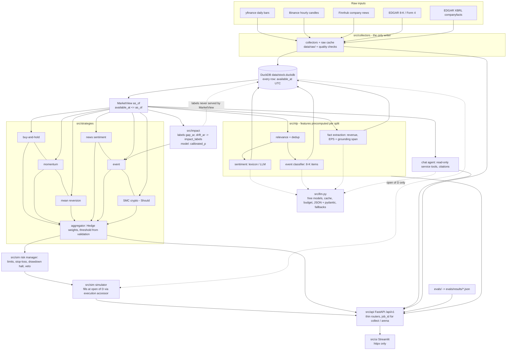

# 02 — Architecture and contracts

Design-phase artifact. Contracts live in code: `src/schemas.py` (records), `src/marketview`
(point-in-time reads), `src/db.py` (single writer, access guard), `src/llm.py` (LLM gateway),
`src/api` (OpenAPI stub, `docs/openapi.json`). Tests pin them: `tests/test_schemas.py`,
`tests/test_marketview.py`, `tests/test_llm_contract.py`, `tests/api/test_contract.py`,
`tests/test_boundaries.py`. Eval plan: `docs/03_eval_plan.md`.

## Data flow



Solid arrows carry data; dotted arrows are model calls or the one sanctioned exception (the simulator
reading the open of D). Everything left of the API is a plain Python service that evals call directly.

## Components

| Component | Purpose | Input → output | Model / tool calls |
|---|---|---|---|
| Collectors | fetch, cache, validate, write | provider JSON → DuckDB rows with `available_at` | yfinance, Binance, Finnhub, EDGAR HTTP; file lock |
| MarketView | point-in-time reads | `as_of` → `PriceBar`, `NewsItem`, `Filing`, `Fact`, `Sentiment`, `Event` lists | DuckDB read-only |
| Relevance + dedup | drop noise and repeats | news → unique, on-topic news | embeddings or hashing; LLM optional |
| Sentiment | tone of a text | text → `Sentiment(label −1/0/1, score)` | lexicon (fallback) / LLM |
| Event classifier | type of event | news or 8-K → `Event(labels[], confidence)` | 8-K index (gold) / rules (fallback) / LLM |
| Fact extraction | numbers from releases | 8-K 2.02 text → `Fact` with `Span` | LLM structured output; XBRL (gold) / regex (fallback) |
| Impact | what tends to follow an event | event, prices → `gap_ar`, `drift_ar` labels; `calibrated_p` | feature model, no LLM |
| Strategies | opinions | `(ticker, as_of, MarketView)` → `Signal` | code; features from DuckDB |
| Aggregator | one decision | `Signal[]` → aggregated `Signal` | Hedge; stacking / LLM researcher (Should, rules as YAML) |
| Risk manager | veto | signal, portfolio → allow / veto | rules from `config/risk.yaml` |
| Simulator | honest P&L | decisions, open(D) → `Trade[]`, `BacktestResult` | code |
| Chat agent | answers with citations | question, `as_of` → `ChatResponse` | LLM + read-only service tools |
| LLM gateway | every model call | prompt, items, schema → validated objects or fallback | OpenRouter free models |
| API | expose each layer | HTTP → schema JSON; long work → `job_id` | FastAPI, thread-pool jobs |
| UI | show, ask | user actions → API calls | Streamlit + httpx |

## Time rules and availability

Decision day D: `as_of = cutoff(D) = 09:00 America/New_York` (`src/marketview/clock.py`). A signal
for D sees every row with `available_at <= as_of`; the fill happens at the open of D, which only the
simulator reads through its execution accessor.

| Record | `available_at` |
|---|---|
| price bar | bar close time (16:00 ET for stocks; candle close for crypto) |
| news | provider `datetime` (publication) |
| filing (8-K, Form 4) | EDGAR `acceptanceDateTime` |
| XBRL fact | filed date of the 10-Q / 10-K (00:00 UTC), i.e. after the 8-K it is gold for |
| sentiment, event, extracted fact | `available_at` of the source text |
| signal | `as_of` |
| trade | fill time (open of D) |
| impact label | not served; forward-looking by construction |

So at the cutoff of D the latest bar is D−1, the overnight filings and pre-market news are visible,
and nothing from D's session is.

### Labels (defined once, used by impact and by the arena eval)

For an event with `available_at = a`, let D be the first trading day with `cutoff(D) >= a`, and
D+1 the next trading day. With `r(x→y) = price_y / price_x − 1` and the same quantity for SPY:

- `gap_ar = r(close(D−1) → open(D)) − r_SPY(close(D−1) → open(D))`. Already realised when we enter
  at the open of D. It measures how much of the event was priced in before our entry. It is **not**
  available to strategies at `as_of` (it needs the open of D); it is a diagnostic label.
- `drift_ar = r(open(D) → close(D+1)) − r_SPY(open(D) → close(D+1))`. The tradable target: enter at
  the open of D, exit at the close of D+1. The impact model predicts `P(drift_ar > 0)` and exposes it
  as `Signal.calibrated_p`.

Both live in `impact_labels` (`src/marketview/schema.sql`), keyed by `source_ref`, computed once per
(ticker, D) and shared by events landing on the same D.

## One input end to end

AAPL files an 8-K with item 2.02 on Monday 2026-09-14, accepted by EDGAR at 17:05 ET (21:05 UTC).

1. **Collect.** `POST /api/v1/collect {"periods": ["validation"]}` → `202 {job_id}`. The collect job
   (the API's only writer, under the file lock) stores `Filing(accession_no=..., items=["2.02","9.01"],
   available_at=2026-09-14T21:05Z)` and its press-release text path; Finnhub news about the release
   arrives with `available_at` = their publication times that evening; the 2026-09-14 bar has
   `available_at = 20:00 UTC`.
2. **Features** (`make features` or the job's second phase). Through `MarketView`: the event classifier
   writes `Event(labels=["2.02"], method="index")` (the index gives it for free; the LLM path is used
   for news), fact extraction writes `Fact(name="revenue", value=..., method="llm", grounding=Span(...))`
   and `Fact(name="eps_diluted", ...)`, sentiment writes a `Sentiment` row per text. All inherit
   `available_at = 2026-09-14T21:05Z`.
3. **Impact.** With later bars present, the labeller sets D = 2026-09-15 (cutoff 13:00 UTC ≥ 21:05 UTC
   of the 14th), `gap_ar` from close(14th) to open(15th), `drift_ar` from open(15th) to close(16th),
   into `impact_labels`. The impact model, trained on `train`, gives `calibrated_p` for this event.
4. **Signals.** `GET /api/v1/signals?ticker=AAPL&day=2026-09-15` builds
   `MarketView.for_trading_day(2026-09-15)`, runs every strategy inside `src.db.guarded()` (so any
   direct DuckDB call raises), gets `Signal`s: event strategy `score=+0.6, calibrated_p=0.62,
   reasons=["acc-...", "revenue surprise +4.1% q/q"]`, momentum `+0.3`, mean reversion `0`, sentiment
   `+0.2`. Hedge weights (from validation) combine them into `aggregated.score=0.41`; the risk manager
   answers `allow`. Response carries the disclaimer.
5. **Simulate.** `POST /api/v1/arena {"split": "validation"}` → job; the simulator fills at the open of
   2026-09-15 through the execution accessor, applies commission and limits, records `Trade`, and the
   `BacktestResult` lands in the leaderboard (`GET /arena` later; now in the job result).
6. **Explain.** `GET /api/v1/events/AAPL` lists the filing, its labels and facts.
   `POST /api/v1/chat {"question": "why did AAPL move on Sep 15?"}` runs the chat agent with
   `as_of = now`, tools = the same read-only services; the answer says the 8-K (2.02, revenue, EPS)
   *was published the evening before* a +x % open and cites `acc-...` and two news ids. Wording is
   co-occurrence only (R11).
7. **Show.** `GET /api/v1/brief` gives the UI the per-ticker card: last close, change, sentiment index,
   events, signal. The UI never touches DuckDB.

## API contract (`/api/v1`, Swagger at `/docs`, export in `docs/openapi.json`)

| Method | Path | Returns | Long? |
|---|---|---|---|
| GET | `/watchlist` | `Watchlist` | |
| GET | `/brief?day=` | `Brief` (per-ticker cards, disclaimer) | |
| GET | `/signals?ticker=&day=` | `SignalsResponse` (all strategies, aggregated, risk verdict) | |
| GET | `/events/{ticker}` | `EventsResponse` (filings, events, facts) | |
| GET | `/evals` | `list[EvalResult]` from `evals/results/` | |
| GET | `/models` | `list[ModelInfo]` from `config/llm.yaml` + budget counter | |
| POST | `/analyze` | `AnalyzeResponse` (sentiment, events, facts for arbitrary text) | LLM, cached |
| POST | `/collect` | `202 JobAccepted` | job |
| POST | `/arena` | `202 JobAccepted` | job |
| POST | `/chat` | `ChatResponse` (answer, citations, disclaimer) | LLM |
| GET | `/jobs/{job_id}` | `JobStatus` | |
| GET | `/health` (no prefix) | `{"status": "ok"}` | |

Every endpoint answers 501 until its service exists; the contract test pins paths, methods, success
codes, 422 validation and the disclaimer fields.

## Module map and boundaries

```
src/schemas.py       records (all with available_at), API bodies, DISCLAIMER
src/db.py            connect(read_only | writer+lock), guarded(), DirectDataAccessError
src/marketview/      MarketView(as_of), clock.cutoff_for, schema.sql
src/llm.py           call_json(..., fallback=) , DailyCounter, DiskCache, BudgetExceeded
src/collectors/      one module per source; run.py --periods
src/nlp/             relevance, sentiment, events, facts; features.py --splits
src/impact/          labels.py (gap_ar, drift_ar), model.py (calibrated_p)
src/strategies/      base.py (Strategy protocol), one module per strategy, arena.py, aggregate.py
src/sim/             execution.py (open_price accessor), risk.py, simulator.py, run.py
src/api/             main.py, routers/*, jobs.py
src/ui/              app.py, client.py (httpx)
```

Boundaries enforced by `tests/test_boundaries.py`: the UI never imports DuckDB or MarketView;
`duckdb.connect` appears only in `src/db.py` and collectors; routers contain no DuckDB, MarketView,
LLM or pandas; strategies, NLP and impact never read the open of D.
