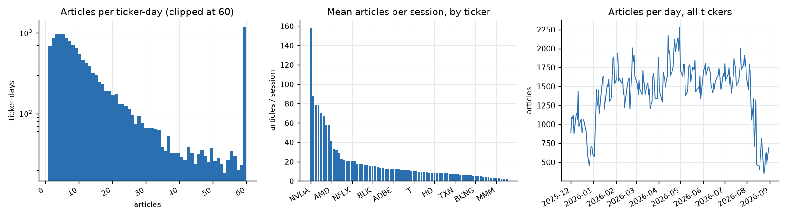
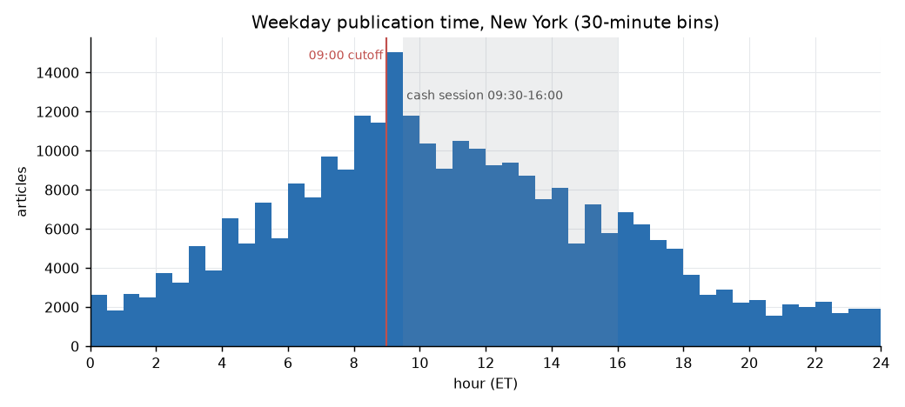
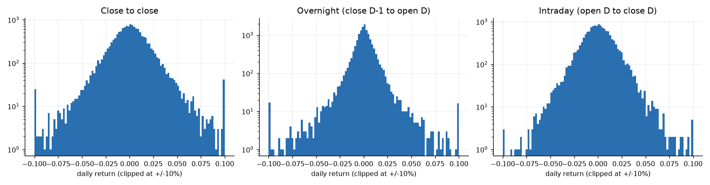
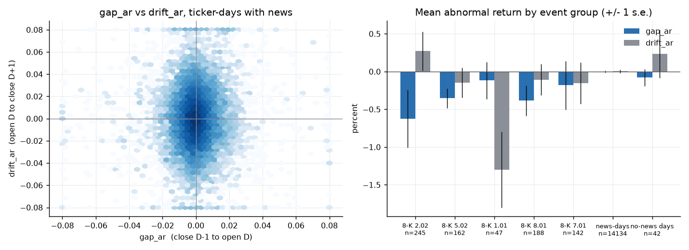

# 02 — Data understanding (EDA)

Generated by `make eda` (`src/eda/run.py`, git `7337b9c`); do not edit by hand. CRISP-DM phase 2, the
gate for data preparation. Figures: `docs/figs/`. Scope: train + validation sessions (188
sessions) for returns and labels, never the test period (R3, D-33). Coverage per source and the
list of holidays: `docs/02_data_sources.md`; rule-by-rule data quality (duplicates, missing days,
UTC, headline length, language, tickers, 8-K headers): `docs/04_data_quality.md`.

Wording (R11): an article or filing *coincided with* or *preceded* a move; none of these tables
makes a causal claim. `gap_ar` and `drift_ar` are defined in `docs/02_architecture.md`:
`gap_ar` = abnormal return close(D-1) to open(D) (already realised when we enter; diagnostic only),
`drift_ar` = abnormal return open(D) to close(D+1) (the tradable target); abnormal = minus SPY.

## 1. News per ticker per day

- 14,126 ticker-days carry at least one article; median 9,
  99th percentile 160 articles. The distribution is heavy-tailed (log axis).
- Busiest names (articles per session): NVDA 158.2, GOOGL 87.9, MSFT 78.8;
  quietest: LIN 1.9, AMT 2.5, MDLZ 2.6. A raw article count is
  therefore a statement about the ticker's usual attention, not about the day: any news-count feature
  must be normalised per ticker (e.g. z-score against its own trailing window).

## 2. Publication hour against the market open

- On weekdays 37.67% of articles appear before the 09:00 ET cutoff, 42.90% before
  the 09:30 open, 39.39% during the session and 17.70% after the close; the busiest hour
  is 9:00 ET.
- Consequence for the time rules: only the before-cutoff share (plus the previous evening and the weekend)
  is usable at the open of day D; session articles can only be used at the next open. This is why
  `decision_day` (first session whose cutoff is at or after `available_at`) is computed per item,
  and why a same-day return is never paired with same-day news in a signal.

## 3. Return distributions

| Return | Std | 1st pct | 99th pct | Excess kurtosis |
|---|---|---|---|---|
| close to close | 2.19% | -5.62% | 6.15% | 9.8 |
| overnight (close D-1 to open D) | 1.36% | -3.75% | 3.85% | 35.2 |
| intraday (open D to close D) | 1.72% | -4.55% | 4.58% | 2.9 |

- All three are fat-tailed (kurtosis well above 0), so mean-based metrics and Gaussian assumptions need
  care; the impact eval reports direction accuracy and AUC rather than R².
- Overnight and intraday moves are of comparable size, so the news published overnight can already be
  partly reflected at the open: this is exactly what `gap_ar` measures.

## 4. gap_ar against drift_ar

Events: 14,134 (ticker, decision day) pairs with at least one article in train + validation, and
2,670 8-Ks (item counts: 9.01 2035, 2.02 880, 8.01 697, 5.02 530, 7.01 505, 5.07 224, 1.01 147, 5.03 107). Means in percent; the 8-K rows are filings whose decision day lies in
train + validation.

| Group | n | mean gap_ar | mean abs gap_ar | mean drift_ar | mean abs drift_ar |
|---|---|---|---|---|---|
| 2.02 | 245 | -0.63 | 4.37 | +0.27 (s.e. 0.26) | 3.13 |
| 5.02 | 162 | -0.35 | 0.95 | -0.15 (s.e. 0.20) | 1.98 |
| 1.01 | 47 | -0.12 | 0.99 | -1.30 (s.e. 0.50) | 2.46 |
| 8.01 | 188 | -0.39 | 1.28 | -0.11 (s.e. 0.21) | 2.13 |
| 7.01 | 142 | -0.18 | 1.99 | -0.16 (s.e. 0.27) | 2.40 |
| news-days | 14134 | | 0.79 | | 2.01 |
| no-news days (random sample) | 42 | | 0.52 | | 1.59 |

- Correlation of gap_ar and drift_ar over news-days: +0.023.
- The mean absolute `gap_ar` on news-days is 0.79 % against
  0.52 % on randomly drawn no-news days (same tickers): days with articles
  coincide with larger opening gaps. After the open, the mean absolute `drift_ar` is
  2.01 % against 1.59 %.
- Signed `drift_ar` means: groups whose mean lies more than 2 standard errors from zero: 1.01 (-1.30 %, n=47). Five groups are tested at once, so one interval
  excluding zero is not strong evidence; the 8-K groups are also small. Any strategy claim has to
  be settled by the arena on `validation`, not by this table.

## Conclusions for the next phase

1. Normalise attention features per ticker; use `decision_day`, not the calendar date, to pair text with prices.
2. Keep headlines flagged by `clean.check_headline` and roundup articles out of labelling sheets and sentiment indices.
3. Strip item headers from 8-K text before classification; the item numbers are the gold labels.
4. Treat the opening gap as largely realised when the strategy enters (`gap_ar`), and judge value on `drift_ar` only.
